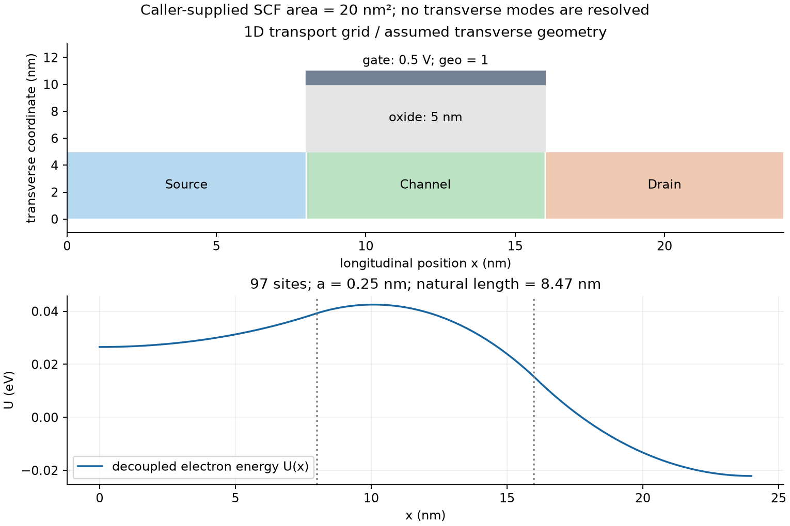
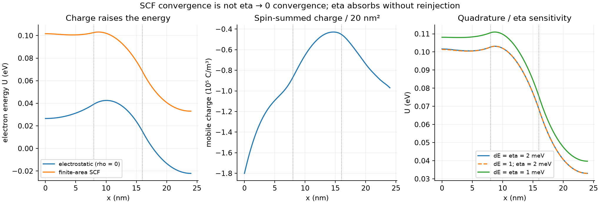
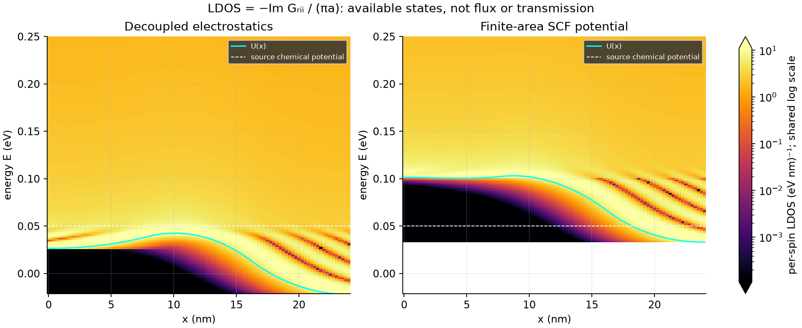
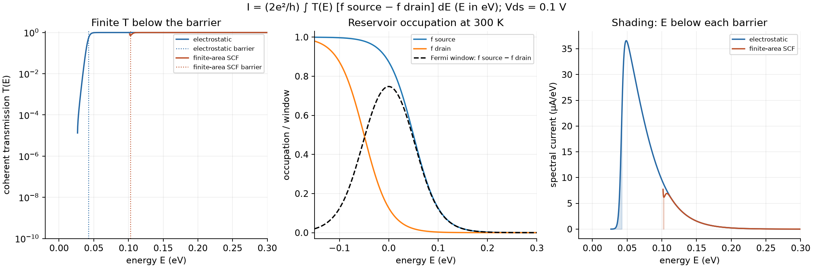
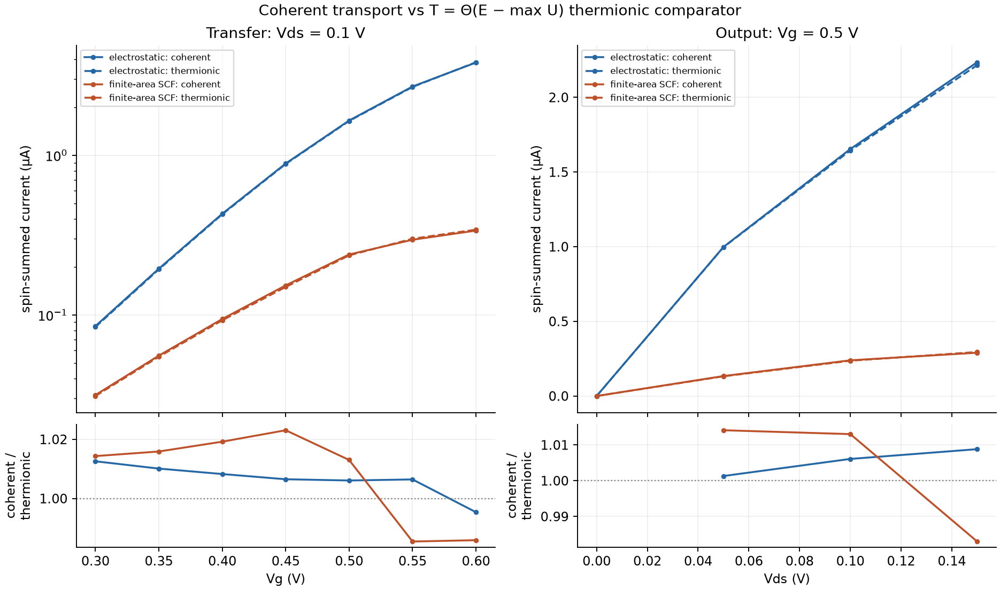

# Coherent-transport calculation gallery

Regenerate from the repository root using the installed updated Python extension:

```bash
.venv314/bin/python scripts/render_demo.py
```

The output-free [notebook](../../notebooks/negforge_demo.ipynb) executes the same
functions. `sanity_checks.json` contains inputs, solver residuals, LDOS statistics,
spectral integration checks, and every I–V point. Failed assertions or SCF solves
stop rendering; missing transport APIs never trigger surrogate curves.
`--electrostatics-only` is an explicit partial-render option.

Use the [setup instructions](../../README.md#python-package--notebook) to create
and activate `.venv314`. The CLI selects the headless Agg backend; importing its
figure helpers leaves the caller's backend unchanged. The notebook explicitly
selects inline PNG display. Verify actual notebook images in a fresh kernel with:

```bash
.venv314/bin/python -m pytest -q -s tests/test_notebook.py
```

The regression requires six executed code cells and five decoded, nonblank
`image/png` display outputs; existing gallery files cannot satisfy it.

## 1. Device geometry and electrostatics



The schematic depicts the declared input, not a transverse simulation. The 1D
chain has 8 nm source, channel, and drain regions; spacing 0.25 nm; 97 sites.
Body and oxide thicknesses are 5 nm, `geo=1`, temperature 300 K, Vg=0.5 V,
Vds=0.1 V. The caller supplies 20 nm² for SCF volume charge, independently
of body thickness; current remains a spin-summed single-mode current.
Endpoint band energies are calculated, not pinned to reservoir chemical
potentials (mu source=0.05 eV, mu drain=-0.05 eV).

## 2. Explicit-area feedback and numerical sensitivity



Electrons raise their potential energy through repulsive feedback. Negative
rho is spin-summed volume charge, in C/m³. Implicit unit-area charge is not a
specified physical cross-section. The iteration residual, quadrature error,
and absorbing eta dependence are separate numerical questions.

| Computed quantity | Value |
|---|---:|
| Natural length (nm) | 8.47318546 |
| Electrostatic barrier (eV) | 0.0425140399 |
| Finite-area SCF barrier (eV) | 0.103121548 |
| SCF iterations | 85 |
| SCF residual (eV) | 9.19553811e-08 |
| Maximum feedback (eV) | 0.0751220087 |
| Peak charge magnitude (C/m³) | 180086.256 |
| Implicit unit-area max feedback (eV) | 0 |
| Barrier: dE=1, eta=2 meV (eV) | 0.103118168 |
| Barrier: dE=eta=1 meV (eV) | 0.110986711 |

The baseline uses dE=eta=2 meV, mixing=0.1, tolerance=1e-7 eV, up to
400 iterations, and the full stored SCF energy bound. Halving dE at fixed eta
barely shifts the barrier; reducing eta shifts it visibly. This is **not** a
claim of eta→0 convergence. Eta absorbs without compensating injection and
is not tunneling or a conserving scattering/dephasing model.

## 3. Available states and potential overlay



LDOS is `-Im G_ii/(pi*a)`, in (eV nm)⁻¹ per spin; it is neither particle
flux nor transmission. Cyan is U(x), white is the source chemical potential.
Both panels use one log normalization and show the same low-energy window
through 0.25 eV. The cap is the larger 99.5th percentile; full sampled arrays
extend beyond this display window. White below the SCF energy grid is
**unsampled**, not zero LDOS. The LDOS helper's fixed retarded broadening is
separate from the declared SCF eta; narrow features require grid checks.

## 4. Coherent transmission, Fermi window, and spectral current



T(E) is computed by `transmission_spectrum`, restricted to the common
propagating lead band. Dotted lines mark each barrier maximum. Finite
transmission below that maximum is sub-barrier transport, not a conclusion
inferred from LDOS. The small sub-barrier interval in the SCF device reflects
its raised source endpoint band edge, not a missing occupied reservoir window.
The Fermi window weights available transmission; shaded spectral-current
areas lie below the corresponding barrier.

For numerical energies in eV, `j(E)=(2e²/h)*T(E)*(f_source-f_drain)` in A/eV.
The extra e converts the integration measure, and spin is counted exactly once.

| Potential | Coherent API (µA) | Thermionic (µA) | Below-barrier fraction | Spectral/API relative difference | Half-step relative change |
|---|---:|---:|---:|---:|---:|
| electrostatic | 1.6542015 | 1.6441824 | 0.0366475 | 5.161e-09 | 1.645e-08 |
| finite-area SCF | 0.23918304 | 0.23610559 | 0.0416469 | 7.673e-05 | 0.0001601 |

The independent midpoint spectrum uses an approximately 0.25 meV energy step,
compares with 0.5 meV, and integrates within the common lead band through
35 kBT above the highest chemical potential or the band ceiling. Assertions
check finite 0≤T≤1, positive biased current, and spectral/API agreement within
3%; the actual errors are tabulated above, not merely the pass threshold.

## 5. Transfer and output results



Every point starts with a fresh device. Solid: coherent `calc_current()`;
dashed: `calc_thermionic_current()` with T=Theta(E-max U). Color selects
potential model, and bottom panels resolve their small current differences.
The 0/0 ratio at equilibrium is deliberately omitted; both zero-bias currents
are asserted zero. All potential/bias calculations and their residuals are
recorded in the JSON. No broad-range subthreshold-swing fit is assumed.

Coherent minus thermionic current is **not the sub-barrier current**:
reflection and finite lead bandwidth also change above-barrier transport.

## Model limits

These are computed examples, not calibrated transistor predictions.
Natural-length electrostatics, finite contacts, effective-mass grid dispersion,
eta-dependent charge, absent transverse/valley structure, and isolated
bound-state occupations limit interpretation. A small iterative residual does
not remove those limitations. See [physics](../PHYSICS.md) and
[explicit-area normalization](../ELECTROSTATIC_GEOMETRY.md).
